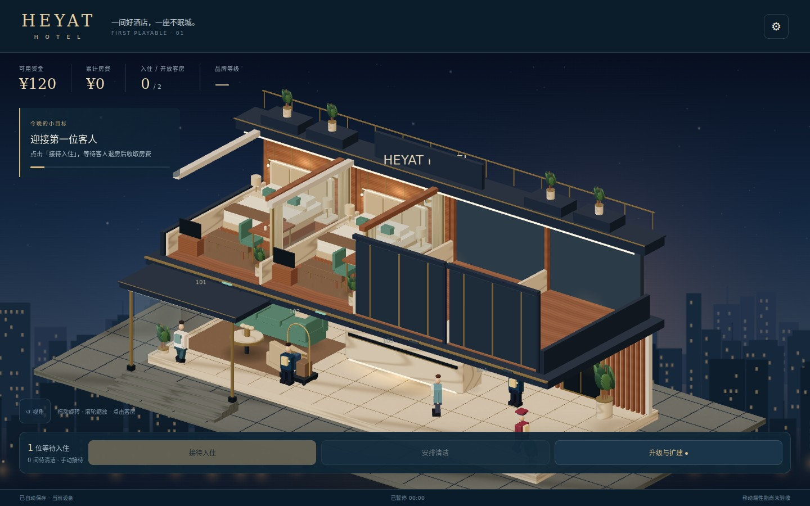
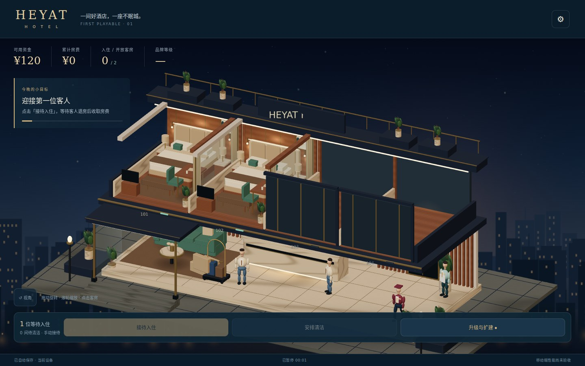

# PR A · 构图、光线与人物精修

## 开工审计与复用

已阅读四份规划：HEYAT_GAME_VISION、HEYAT_DEVELOPMENT_PLAN、HEYAT_WORK_KICKOFF、HEYAT_WORK_TICKETS；并核对 DIORAMA_V01、PLAYTEST_V01、ART_STAGE1_AUDIT / VALIDATION、HYA_ART_PERF_01、HYA_ART_STAGE2。

本轮基线为 main `f7fd8be2ae68039b58503881da77a9d6fa42e1f8`，PR #7、#8、#9 均已合并。旧文档中的「未合并」「人物/背景尚未开始」属于历史阶段记录。本轮直接复用精品客房、大堂、PBR/静态 light/AO、按需 PMREM、Low/Medium/High 材质分档、城市贴图与经营事件桥接，不重建这些模块。

## 增量范围

- 正交镜头更接近前剖面，减少屋面遮挡；压暗既有城市纹理，调整冷暖主光与环境反射强度，让客房成为视觉中心。
- 入口两侧增加共享实例化街灯与低矮花台，中间保留通行与视线。
- 将 26 个三 Mesh 人物池收敛为六名代表人物，每人一个共享服装网格、11 关节骨架；四套顶点色服装、正常头身比例，无面部动画。
- 共用行走/接待/清洁/待机姿态函数。清洁员读取 CLEANING，住客优先读取 RESERVED / OCCUPIED；没有这些业务事件时返回大堂。经营人数与渲染人数分离。
- 近景蒙皮、中景复用同网格静态姿态、远景共用 Sprite；缩远时降低动画细节。无新增实时光或动态阴影。
- UI 留给独立 PR B；src/core、存档 schema/key 与模拟计时不变。

## 边界

新参考 image(5).png 用作深蓝/暖金、镜头与 UI 层级参考，不将其中地图、商店、技能、收入速率等未实现入口制作成假功能。当前仍为三层十二房原有业务容量。人物进出电梯、跨层连续寻路与离店过渡仍未完成；六名代表角色在状态切换时重新定位，不能称为完整人员 AI。

真实渲染截图、测试命令与性能采样见随本 PR 提交的验证记录。MOBILE_PERF_UNVERIFIED；不自动合并。

## 审核预览与真实证据

[PR A 独立运行地址](https://heyat-polish-a.garronmeng.chatgpt.site)。部署 succeeded；与测试构建使用同一份 dist。`npm ci && npm run build && npm run preview` 可本地复现。

| main 修改前                                         | PR A 修改后                                        |
| --------------------------------------------------- | -------------------------------------------------- |
|  |  |

同一 1440×900 页面、High、101/102 开放夹具，经营暂停；本 PR 有意调整默认机位，故这组是「相同状态与默认重置视角」的构图对照，而非相机矩阵完全相同。人物待机姿态不同。截图来自生产构建的真实 Three.js / WebGL 2。

[竖屏前](evidence/art-polish-a/before-portrait.jpg) · [竖屏后](evidence/art-polish-a/after-portrait.jpg) · [真实人物动作片段](evidence/art-polish-a/people-motion.gif)。GIF 是连续实机帧裁切与时间压缩，只用于确认人物确有运动，不代表实际 FPS；原 PNG 为测试输出。

## 性能记录

Linux x86_64 容器、Chromium 141.0.7390.37、ANGLE Vulkan SwiftShader 软件渲染；各请求 120 秒采样，统计 High、1440×776、启动 10 秒后的稳定画布样本。导出时设置抽屉会缩窄画布，已排除其样本；report 顶层 viewport 是导出瞬间而非采样筛选尺寸。

| 指标                 |         main |         PR A |
| -------------------- | -----------: | -----------: |
| 稳定样本数           |          106 |          102 |
| Draw Calls 中位数    |           81 |           66 |
| 三角形中位数         |       70,346 |       69,470 |
| 软件 FPS 中位数      |         2.04 |         2.01 |
| P95 帧时间中位数     |    1010.8 ms |    1031.7 ms |
| 驻留几何             |           18 |           14 |
| 纹理对象             |           20 |           26 |
| 浏览器粗粒度 JS heap | 11,200,000 B | 11,900,000 B |

新增六个小型骨骼矩阵纹理，因此纹理对象数增加；表面贴图估计均为 3,189,419 B，不含完整环境/骨骼/驱动占用。WebGL 无真实 VRAM 字节接口；这些数据不证明无内存泄漏，尚未做真机长时热稳定测试。Draw Calls 降低没有转化为本软件环境的 FPS 提升。

[原始前报告](evidence/art-polish-a/before-report.json)、[原始后报告](evidence/art-polish-a/after-report.json)、[汇总](evidence/art-polish-a/summary.json)。iPhone Safari 30 FPS、桌面硬件 Chrome 60 FPS 均未验收。

## 回归结果与保留问题

`npm test` 18/18、`npm run typecheck`、`npm run lint`、`npm run build` 均通过；完整生产 Chromium / SwiftShader E2E 12/12 通过（3.5 分钟），包含动作实帧采集、故障、上下文恢复、横竖屏、完整扩建与终局。新增关节权重/人体尺寸、房态动作映射、只读快照与六人上限测试；原首单/清洁/升级/存档断言未删减。渲染 chunk 632.19 KB / gzip 165.46 KB，Vite 500 KB 告警仍存在。

仍待精修：程序化材质与模型距参考图摄影级品质有差距；入离店/电梯过渡未连续化；清洁动作无独立工具动画；远景 Sprite 为共用剪影；未做 KTX2、真实设备热机与完整内存趋势验收。零新增动态阴影与逐房实时灯。关闭未合并 PR 即可取消本次代码；审核预览与原试玩相互独立。OPEN — DO NOT AUTO-MERGE。
