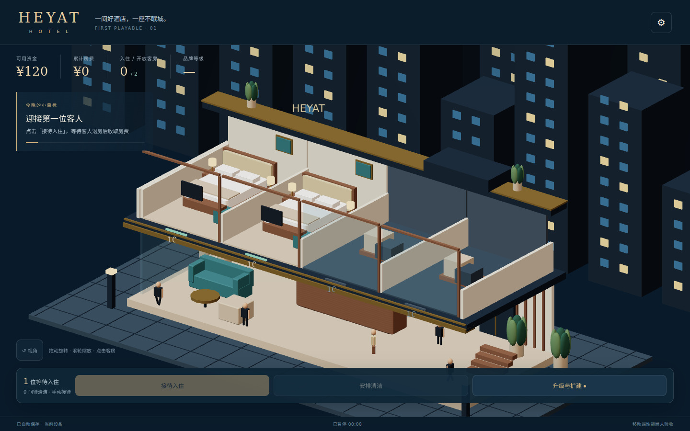
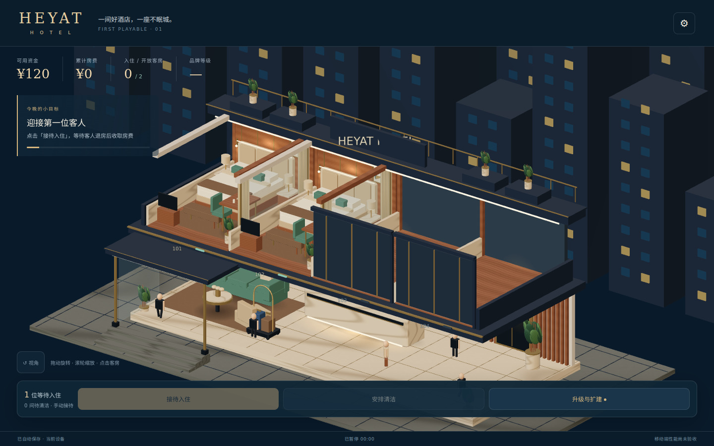

# 阶段一：实机渲染、回归与性能记录

日期：2026-10-22。审核分支 `feat/premium-diorama-stage-1`，基线 `03d92ebd78c0407aa7d090ebdfb6829eadfa2c00`。**不自动合并；阶段二、三未启动。**

[独立私有审核预览](https://heyat-art-stage-one.garronmeng.chatgpt.site) · [工程审计与范围](ART_STAGE1_AUDIT.md)。发布平台返回 succeeded；发布文件与测试构建逐个 SHA-256 相同。原第一版试玩地址保持原版。

## 同机位实机对比

以下为实际 Three.js/WebGL 2 渲染的截图，无 AI 图片替换；JPG 为原始 PNG 的压缩副本。桌面画面 1440×900，画布 1440×776，High、DPR 1。两次均用 101/102 开放、暂停经营、相同正交相机/目标/投影的夹具；角色仍有待机动画，因此人物姿态不完全相同。夹具不改变新游戏默认容量。

| 修改前                                            | 修改后                                           |
| ------------------------------------------------- | ------------------------------------------------ |
|  |  |

[竖屏修改前](evidence/art-stage1/before-portrait.jpg) · [竖屏修改后](evidence/art-stage1/after-portrait.jpg)。UI 源文件与摄像机机位保持不变。房间 103/104 未开放时显示封闭立面，购买后仍通过原升级规则变为完整客房。

## 真实执行结果

| 命令                                                                     | 结果                                                    |
| ------------------------------------------------------------------------ | ------------------------------------------------------- |
| `npm run typecheck`                                                      | 通过                                                    |
| `npm run lint`                                                           | ESLint / Prettier 通过                                  |
| `npm test`                                                               | 14/14 通过                                              |
| `npm run build`                                                          | 通过；渲染模块 618.30 KB / gzip 161.20 KB，保留体积告警 |
| `npm run test:e2e`                                                       | 11/11 通过，约 3.3 分钟，单浏览器串行                   |
| `ART_SAMPLE_MS=120000 npm run test:e2e -- --grep 'stage one repeatable'` | 修改前/后分别执行，均通过；请求 120 秒采样              |
| `git diff --check`                                                       | 通过                                                    |

回归覆盖：真实像素及零外部资源请求、WebGL 2 不可用、入口/动态模块失败、丢失与恢复上下文、首单/清洁/升级/重载、损坏存档保留/导出/确认重开、横竖屏操作边界、完整扩建与终点。经营内核、存档 schema/key、应用装配、UI 和人物代码均无修改。

软件 WebGL 四浏览器并发出现资源争用与超时；改为 1 worker、90 秒整体用例预算，保留资金与房态断言。上下文测试保存原扩展 handle，先观察丢失提示再发起恢复，取代 700 毫秒定时竞争。PMREM 在上下文恢复后重新生成，避免 render target 像素丢失造成反射异常。

## 测试环境与性能

环境：Linux x86_64 容器 / Chromium 141.0.7390.37 / ANGLE Vulkan SwiftShader 软件渲染，**不是用户桌面 GPU 或 iPhone**。每次独立运行；汇总 High、1440×776 且启动 10 秒后的采样，中位数取自滚动采样器输出。原采样器忽略 ≥2000 ms 间隔，因此不能用此数据验收极端卡顿或硬件 FPS。

| 指标                       | 修改前     | 修改后                                        |
| -------------------------- | ---------- | --------------------------------------------- |
| 稳定视口样本数             | 108        | 104                                           |
| Draw Calls（中位数）       | 83         | 105                                           |
| 三角形（中位数）           | 21,912     | 57,380                                        |
| 驻留几何资源               | 6          | 9                                             |
| 软件渲染 FPS（样本中位数） | 8.45       | 2.02                                          |
| P95 帧时间（样本中位数）   | 217.0 ms   | 1005.7 ms                                     |
| 纹理对象数                 | 原版未采集 | 19（包含文字、环境等）                        |
| 表面纹理 GPU 字节估算      | 原版未采集 | 3,189,419 B，约 3.04 MiB，RGBA + mip 上界估算 |
| 浏览器报告 JS Heap         | 原版未采集 | 10,000,000 B，浏览器粗粒度值，非精确内存测量  |
| 实际 VRAM 字节             | 不可得     | WebGL API 不提供，未冒充纹理估算为 VRAM       |

原始数据：[修改前](evidence/art-stage1/before-report.json)、[修改后](evidence/art-stage1/after-report.json)、[汇总](evidence/art-stage1/performance-summary.json)。软件渲染成本明显增加；此阶段未满足任何目标设备的 FPS 门禁。

**MOBILE_PERF_UNVERIFIED**：iPhone Safari 30 FPS 尚未实机验收；桌面 Chrome 60 FPS 同样没有目标 GPU 的实测依据。竖屏截图只证明响应式功能。后续需记录实际机型、OS、浏览器、画质、屏幕方向，连续运行至少 15 分钟并导出性能报告。

## 问题清单与后续阶段

1. 仅收到一张目标示意图，缺少第二张建筑主参考；当前不能验收与第二张参考的造型一致性。
2. 人物仍为原简模与 LOD，背景仍为原实例化城市，UI 未整理；按用户指定的阶段二/三处理。
3. 光照使用分析式静态 light/AO atlas、接触阴影贴片、Emissive 与一次性预过滤环境；不是路径追踪烘焙，也未使用重型 Bloom/SSAO/SSR。离线高质量光照与摄影级 PBR 资产尚待精修。
4. 表面纹理为确定性程序纹理/法线；尚未做 KTX2/Basis GPU 纹理压缩。小尺寸共享图先控制显存规模，压缩与进一步 LOD 在阶段三验证。
5. 阶段三重点检查着色成本、首次 shader 编译、透明叠绘、不同画质下 GPU 时间与十二房最繁忙场景；不能将软件渲染 FPS 等同设备性能。
6. 材质/建筑明显增加细节，但完整目标图的光影、人物和城市氛围仍需后续阶段；本 PR 为阶段一审核成果。

回滚：PR 未合并时关闭分支；独立预览可保留供对照。当前发布与 main、原试玩地址相互独立。
