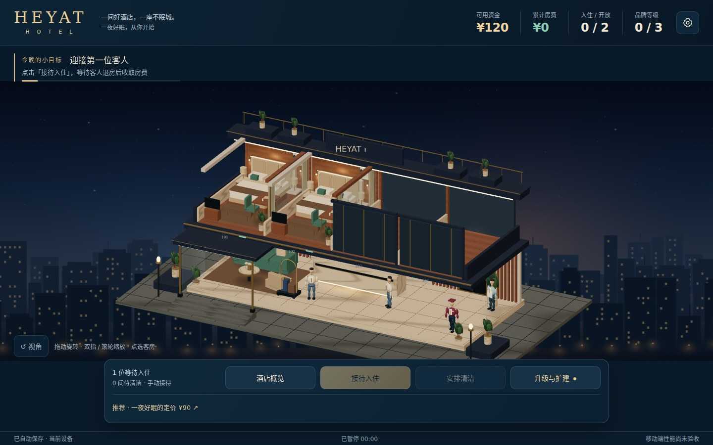

# PR A + PR B · 组合验收

日期：2026-10-22。只在 `review/art-ui-combined` 中组合验证；**main、PR #10、PR #11 均未合并**，不新增第三个功能 PR。

- A：`27d3f52c9409c2c0569522225a2ee8ca9c6e2d0b`，远端 HEYAT CI #34 全绿。
- B：`7d27fc8cf7dd21dd9bbd42f0954c17dd47b649e5`，远端 HEYAT CI #35 全绿。
- 组合运行地址：https://heyat-art-ui-review.garronmeng.chatgpt.site 。私有审核部署 succeeded；不覆盖原试玩、A 或 B 独立预览。

## 真实画面

[手机竖屏](evidence/combined-review/portrait.jpg)。截图为真实 Three.js / WebGL2 生产渲染，非 AI 图片。High，1440×900 页面 / 1440×566 画布、390×844 手机模拟，101/102 开放且经营暂停的同一审图夹具。六名人物仍保留视觉待机动画。

## 验证结果

- `npm test`：19/19，通过人物关节/状态映射、升级效果预览、经营与存档单测。
- `npm run lint`、`npm run typecheck`、`npm run build`：通过。
- `ART_SAMPLE_MS=120000 npm run test:e2e`：原有 13/13 通过，3.9 分钟；涵盖首帧、失败与重试、首单/退房/清洁/购买/刷新、损坏存档、上下文恢复、画质切换、横竖屏、抽屉焦点、扩建与终局。
- 新增组合专用用例：通过可见床具点选真实 101 客房，检查客房标题/净房状态/资金不变，1/1 通过（8.5 秒）。[选房实帧](evidence/combined-review/selected-room.jpg)。见 `tests/e2e/combined-review.spec.ts`；只用于这个固定的 A+B 审核机位，不将像素坐标作为通用业务接口。
- 发布静态输出与本次构建逐文件 SHA-256 比较；正式经营和 v1 存档逻辑没有追加修改。

首次运行因本轮执行环境的 Playwright 浏览器缓存缺失而无法启动浏览器；重新安装锁定版本并补齐测试环境中文字库后重测。此为测试环境问题，未通过放宽业务断言解决。

## 两分钟软件渲染记录

Linux x86_64 / Chromium 141.0.7390.37 / ANGLE Vulkan SwiftShader。High，1440×566，独立请求 120 秒，排除启动前 10 秒和导出设置时改变画布尺寸的样本。

| 指标                 |       组合版 |
| -------------------- | -----------: |
| 稳定样本数           |          107 |
| Draw Calls 中位数    |           66 |
| 三角形中位数         |       69,470 |
| 软件 FPS 中位数      |         3.04 |
| P95 帧时间中位数     |     628.2 ms |
| 驻留几何 / 纹理对象  |      14 / 26 |
| 浏览器粗粒度 JS heap | 12,700,000 B |
| 表面纹理保守估算     |  3,189,419 B |

[原始报告](evidence/combined-review/report.json) · [汇总](evidence/combined-review/summary.json)。report 顶层 viewport 是打开设置导出时的瞬时尺寸，筛选以 samples 的 1440×566 为准。纹理估算不等于完整显存，WebGL 不暴露真实 VRAM，未证明长期内存稳定。

## 保留项

MOBILE_PERF_UNVERIFIED。没有 iPhone Safari 或桌面真实 GPU 的 FPS 门禁、15 分钟热机或真实触屏验收；云端 SwiftShader 不能代替它们。完整人物进出电梯/离店过渡、清洁工具动画、KTX2、摄影级模型与光照仍未完成。634.38 KB / gzip 166.25 KB 的渲染 chunk 仍触发 500 KB 构建告警。

本轮补齐组合验证与预览，没有以新 PR 重复开发已经完成的功能。审核 A/B 后可由用户分别决定合并；组合审核分支不用于自动更新 main。
