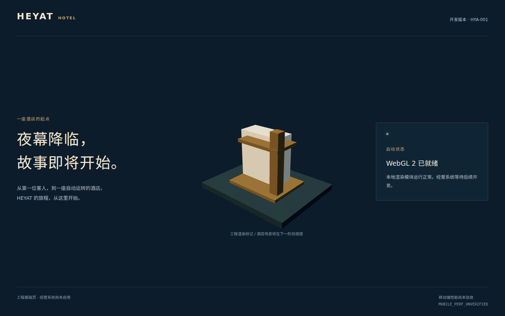

# HYA-001 验证记录

日期：2026-10-22（北京时间）。范围：仅工程初始化；基于 main `f9153637dc9734e1f6e9dc826666d9ad18215177`，分支 `chore/heyat-bootstrap`。

## 仓库与基线

- 已完整读取 README、GAME_VISION、DEVELOPMENT_PLAN、WORK_TICKETS、WORK_KICKOFF 五份文档。
- 初始仓库只有这五份文件，默认分支 main，无已有开放 PR、无工程/CI/AGENTS.md。
- GitHub 连接显示 push 权限可用。命令行克隆缺少私有仓库凭据，因此通过已连接的 GitHub API 读取精确基线并提交 feature branch；未更改 main。
- 本轮以用户及 HYA-001 的范围为准。开发计划末尾的 W1 综合指令包含后续 Ticket 内容，本轮不执行。

## 架构决策

- TypeScript strict + Vite + 本地打包 Three.js WebGLRenderer，显式申请 WebGL 2，失败不降到 WebGL 1。
- 原生 DOM/CSS UI。core 只提供不可变初始状态骨架；不预设未验收的经济模型。app 单向组装 core/render/ui，渲染不修改业务状态。
- 当前场景只有共享一个 BoxGeometry、三个材质的原创几何标记，无酒店、人物、外部资产或真实品牌素材。
- 动态入口加载渲染模块；独立经典脚本 boot.js 在入口模块失败/30 秒超时时提供静态说明和重新加载。Vite 会重写入口并移除原 script ID，加载守卫采用捕获阶段 script error 监听。
- 清理 ResizeObserver、事件、动画和 GPU 资源；后台暂停绘制。上下文丢失提供重新加载；原位自动恢复属于 HYA-003。
- 固定 DPR 上限 1.5 只是基础画布分配保护。LOD、实例化、烘焙光照、画质分档及自动降级没有在本 Ticket 实现。
- Node 24.19.0 / npm 11.9.0；所有直接依赖精确版本，提交 npm lockfile。Playwright 固定 1.56.1：本环境最新版本的浏览器下载损坏，使用已成功获取的 Chromium 141 构建完成验证。
- Vite dev/preview 默认绑定 127.0.0.1；如需局域网真机测试，使用 `npm run dev -- --host 0.0.0.0`，在受信任网络上运行。
- 静态构建使用相对 base，支持部署到子目录。本轮没有创建公开托管或部署工作流。

## 实际执行

环境：Linux x64、Node v24.19.0、npm 11.9.0；Three.js 0.186.1、Vite 8.3.5、Vitest 5.0.5、TypeScript 6.0.3、ESLint 10.13.0。浏览器为 Playwright Chromium 141.0.7390.37、SwiftShader 软件渲染；不是用户桌面集显或 iPhone。

| 检查          | 命令                                      | 结果                                                                  |
| ------------- | ----------------------------------------- | --------------------------------------------------------------------- |
| 清洁安装      | `npm ci`                                  | 成功，144 packages，退出码 0                                          |
| 格式/代码检查 | `npm run lint`                            | ESLint、Prettier 全通过，退出码 0                                     |
| 类型          | `npm run typecheck`                       | 通过，退出码 0                                                        |
| 单元测试      | `npm test`                                | 1 文件 / 3 测试通过                                                   |
| 开发启动      | `npm run dev -- --port 5175 --strictPort` | 浏览器加载成功，输出 DEV_SMOKE_PASS: WebGL 2 已就绪                   |
| 生产构建      | `npm run build`                           | 成功，最后清洁安装后构建 196 ms；有模块体积告警                       |
| 浏览器安装    | `npx playwright install chromium`         | 首下载源损坏；安装器备用源成功下载 Chromium / headless shell / ffmpeg |
| 生产 E2E      | `npm run test:e2e`                        | 5 测试通过，2.9 秒，退出码 0                                          |

E2E 覆盖：真实 WebGL 2 上下文及已绘制像素（非空 canvas）、页面脚本无未捕获错误、运行时零外部资源请求、1440 × 900 桌面与 390 × 844 竖屏无横向溢出、WebGL 2 不可用时的错误和重试恢复、入口网络失败的静态兜底及重试、动态模块失败提示、真实 WEBGL_lose_context 扩展触发后的提示。

单元测试覆盖渲染循环重复启动保护、暂停取消、停止期间不绘制、恢复绘制、绘制内部停止后不再排帧，以及零尺寸/高 DPI 画布边界。

### 截图

以下为上述生产构建的真实浏览器截图。中文采用测试机系统级 Noto Sans SC；字体未加入工程或运行时下载。

[竖屏截图](evidence/hya-001-portrait.png) · [WebGL 2 不可用截图](evidence/hya-001-webgl-unavailable.png)

### CI

`.github/workflows/ci.yml` 在 PR、main/初始化分支 push 及手动触发时执行 npm ci、lint、typecheck、unit、build、Chromium E2E；初始化分支支持独立检查，避免完全依赖首次 PR 事件。只读 contents 权限，不部署、不合并。浏览器证据上传为 `heyat-browser-evidence`，保留 14 天。远端实际结果以本 PR 的 Checks 和最终 PR 描述中的运行状态为准；本地通过不等于远端已通过。首次创建 PR 后 API 尚未返回运行记录，因此增加初始化分支 push 触发后再次核验。

## 体积、风险与验收边界

- 生产主渲染块 530.14 kB / gzip 132.30 kB，触发 Vite 默认 500 kB 告警；未通过抬高阈值隐藏告警。另有 HTML 2.51 kB、入口 JS 2.78 kB、CSS 2.91 kB 和独立 boot.js。Source maps 用于调试，预览分发时总文件体积应包含它们。
- **MOBILE_PERF_UNVERIFIED**：没有 iPhone Safari 实机数据；未验收 30 FPS。桌面 60 FPS 也没有普通集显硬件上的测量。本轮 SwiftShader 只验证功能。
- 竖屏截图是桌面 Chromium 视口测试，没有模拟或宣称完整 iPhone Safari 兼容性。
- 不支持 WebGL 2 时仍可阅读说明并重试；当前不存在可运行的低配经营模式，因为 HYA-001 没有经营功能。
- 上下文丢失采用整页重载；后续经营加入前需实现并验证原位恢复与存档，当前无业务数据可丢失。
- HEYAT 是工作名，商用品牌核验仍按产品基线处理；未引入未授权素材。

## 下一轮建议（本轮未实施）

1. **HYA-002**：原创模块化大堂 + 两间客房 + 六位活动角色，固定 3/4 相机和有限拖动/缩放；从一开始共享材质/几何，保留角色 LOD 接口，提交动态录屏和资产统计。
2. **HYA-003**：在该场景接入 FPS、P50/P95、draw calls、三角形、内部分辨率；Low/Medium/High 实际改变渲染，提供 2 分钟导出采样及上下文恢复。准备 iPhone 12/13 Safari 实机记录模板，真机性能证据形成前不扩张精细资产生产。

审核状态：OPEN — DO NOT AUTO-MERGE。回滚方式：未合并时关闭 PR；合并后以独立 revert PR 撤销初始化提交，保留原五份规格文档。
