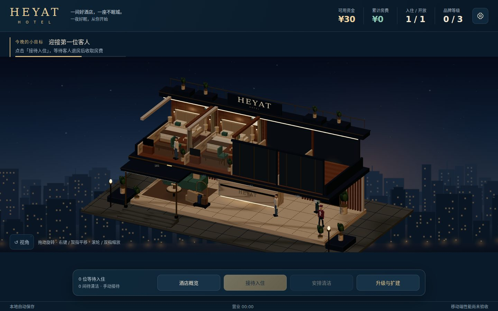
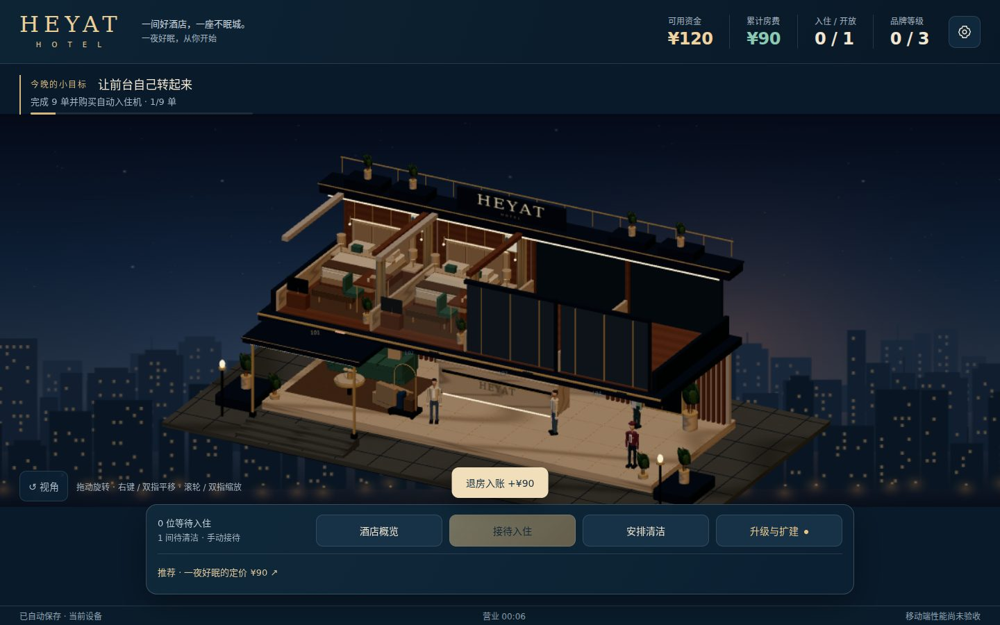

# HYA-N01 · 推荐栏出现时操作区跳动

基于 main 0ded498。真实退房订单令资金从30→120、首次出现可买升级时，原推荐按钮从hidden变为可见，操作区高度76→130px，顶边和三个按钮向上移动54px；画布矩形实际未变。购买后隐藏该按钮则反向跳动。

固定推荐按钮44px行高并永久保留占位；不可购买时禁用、显示经营提示、清空data-value，不能点击失效升级。长标题单行截断；手机横屏沿用原有隐藏该行的布局规则。没有修改资金、房态、升级或存档。

新增纯函数recommendationView及单测；新增真实WebGL E2E以退房触发可负担阈值、真实购买后回到无推荐状态，精确比较画布/操作区/接待/清洁/升级按钮的x/y/w/h，均不变。另检查320/390竖屏及844横屏的长短文本切换；原单抽屉/焦点/触控测试保留。串行CPU WebGL CI总预算由15→30分钟，测试断言未减少。

验证：20/20单元测试、typecheck/lint/build通过；相关2/2浏览器测试通过。修改前真实矩形记录54px跳动，修改后为0px，原始JSON在evidence/n01。截图均1440×900、相同订单夹具、同机位；游戏人物有循环姿态时间差。截图来自实际Three.js生产构建。

| 状态               | 修改前                                     | 修改后                                    |
| ------------------ | ------------------------------------------ | ----------------------------------------- |
| 退房前，无可买升级 |  |  |
| 退房后，出现推荐   |   |   |

运行：npm ci / npm run build / npm run preview。现有组合试玩不覆盖。变更：index.html、styles.css、game.ts、recommendation.ts、两个测试、CI预算，以及本轮审计/回放文档和脚本。已知边界：长名称截断，横屏不显示推荐行；iPhone Safari真机未验证。后续点击反馈只能使用已预留容器，不能改变行高。OPEN，等待CI与用户审核，不自动合并。
