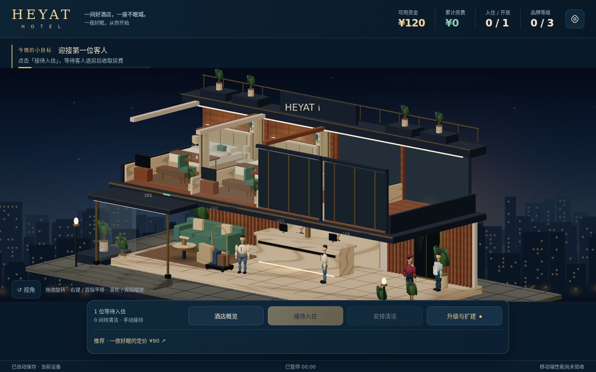
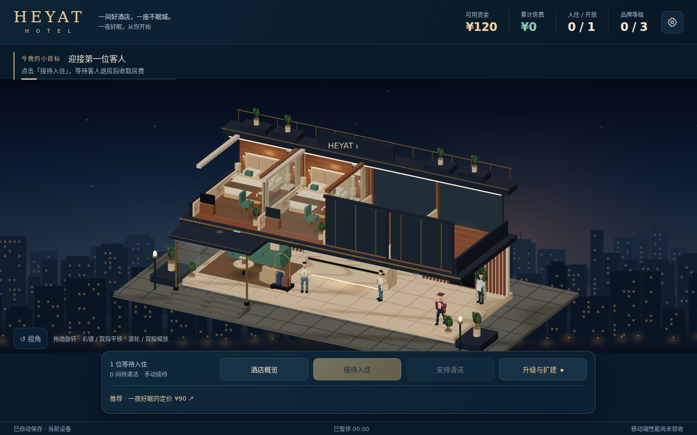

# 人物与字标 · 实帧对照

修复 PR #13，基线 main c7a0799。复现用户 image(6).png 中的斜视断字与木偶式人物；前后均使用初始1间营业客房、暂停、High、1440×900页面、相同初始机位与相同鼠标脚本。惯性收敛和待机姿态存在少量时间差，不将这组图片称为逐像素相同相机矩阵的比较。

| 修改前                                                     | 修改后                                                    |
| ---------------------------------------------------------- | --------------------------------------------------------- |
|  |  |
|  |  |

全部来自生产构建真实 Three.js / WebGL2。未用 AI 图替代，也未修改用户附件。截图为原PNG的JPG副本。采集已等待画质/尺寸变化后的实际渲染帧并检查非黑色像素，避免将清空画布后的瞬间作为证据。

## 功能与视觉检查

- 屋顶 HEYAT/HOTEL 完整贴合牌面，不再以朝向相机的文字穿过实体板；侧面透视与牌面一致。
- 前台铜色字标在柜台正面可读，不再被后墙和楼板裁切。
- 人物肩宽、头身和肢体收窄，以连贯衣裤代替球形关节；待命清洁员、住客避开盆栽和桌椅，行李员朝向与速度方向一致。
- 共用角色网格、材质、骨骼与LOD，标识自有几何/材质/纹理随建筑释放；没有新增经营状态或存档版本。

## 验证

19/19单测，typecheck、lint、build、diff-check通过；完整组合生产E2E 16/16（3.0分钟），含默认机位点选101、自由相机复位、经营/升级/存档、横竖屏与上下文恢复。截图等待实际帧的采集修正后，视觉专项单独复测1/1（40秒）；main/PR的CI套件不含review分支额外点选用例，为15项，远端状态见PR。

运行：https://heyat-art-ui-review.garronmeng.chatgpt.site 。部署 succeeded，11个输出文件逐一SHA-256匹配本次测试构建。之前的功能入口、自由相机和存档兼容性保持。

## 短程诊断

Linux x86_64 / Chromium141 / ANGLE SwiftShader软件渲染。抓图过程包含相机运动与设置抽屉尺寸变化，没有2分钟稳定视角采样，以下只供定位资源成本，不作FPS优化或硬件达标结论。

| 指标                |           前 |           后 |
| ------------------- | -----------: | -----------: |
| 导出时画布          |     1070×566 |     1070×566 |
| 样本数              |           19 |           20 |
| Draw Calls中位数    |           68 |           68 |
| 三角形中位数        |       69,474 |       63,630 |
| 软件FPS中位数       |         3.34 |         3.05 |
| 几何对象            |           14 |           16 |
| 纹理对象            |           26 |           26 |
| 浏览器粗粒度JS heap | 12,700,000 B | 11,200,000 B |

[原始前报告](evidence/wordmark-people/before-report.json) · [原始后报告](evidence/wordmark-people/after-report.json) · [汇总](evidence/wordmark-people/summary.json)。标识平面增加2个几何资源；字标纹理从512×128提升至1024×256，两个RGBA+mip估计约2.67MiB，相对原来约增加2MiB，不包含在surfaceTextureBytesEstimate中。真实VRAM未暴露，不能由这些短程/粗粒度数据宣称内存稳定或优化成功。

MOBILE_PERF_UNVERIFIED；iPhone真实触控、30FPS热机与桌面真实GPU60FPS仍待设备验收。人物仍是轻度风格化的程序模型，未宣称摄影级人物或完整表情动画。
