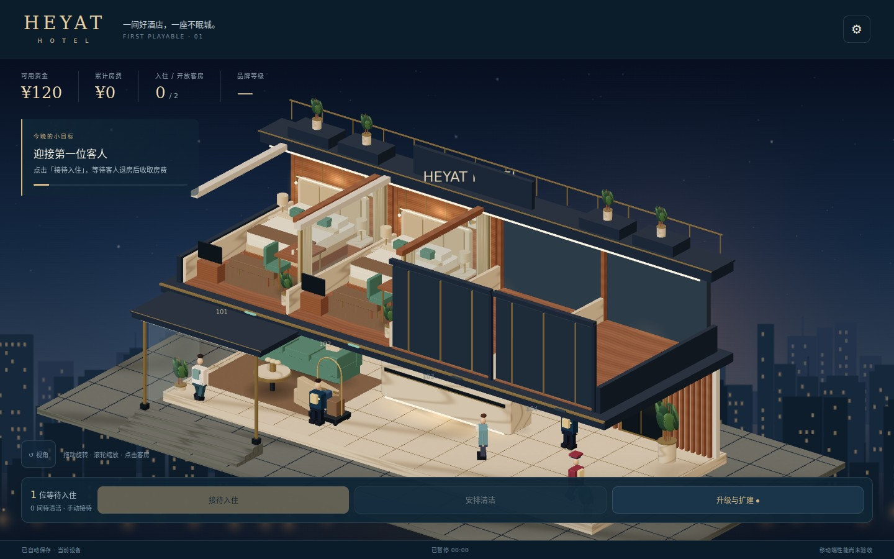
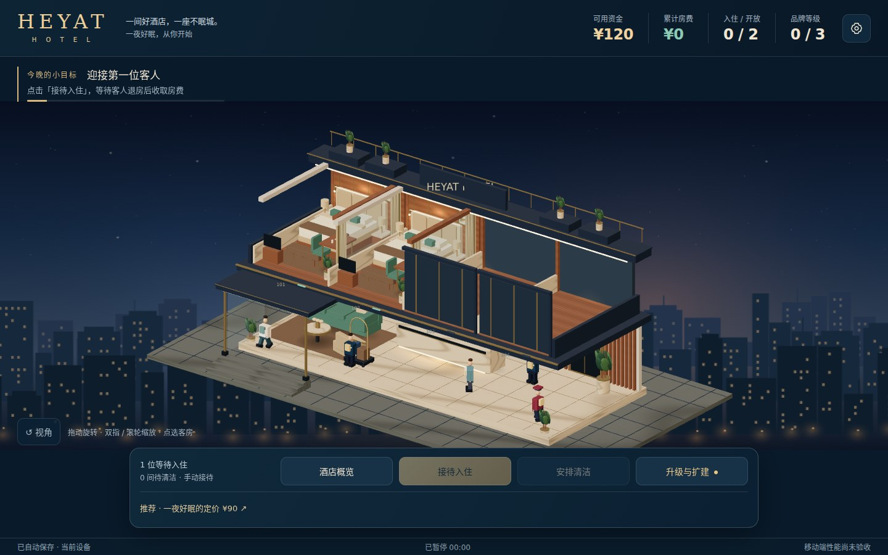

# PR B · UI 与手机交互视觉规范

## 依据与边界

已核对四份 HEYAT 规划和已完成的美术/性能文档，基于已合并 PR #7–#9 的 main `f7fd8be`。本 PR 可独立合并，不依赖 PR A；仅修改 HTML、UI、相关测试与本记录，不修改经营/存档或 3D 模块。

## 视觉与交互规则

- 深夜蓝底、海军蓝容器、黄铜金主要按钮、象牙白正文、青绿色收益。正文 14px、辅助信息 12–13px，数字采用 tabular-nums。
- 顶部固定资金/累计房费/入住容量/品牌四个真实指标；手机保留前三个，品牌可在酒店概览查看。没有伪造现金每分钟、星级或新币种。
- 单一目标轻量条、中央 3D 画布、底部经营操作与下一项可负担的推荐升级。酒店概览、接待、清洁、升级入口均可达。
- 只显示一个管理抽屉；桌面为右抽屉，打开时为建筑重新预留空间；手机竖屏为可滚动底部抽屉，横屏为右抽屉。抽屉不滚动整个网页。
- 按钮/选择框触控目标至少 44 CSS px；支持安全区与 320px 窄屏。禁止依赖 hover；不可用操作有状态/缺款/前置条件说明。
- 升级显示当前→升级后指标，读取既有 rates 配置、用临时快照计算，不修改真实状态；购买仍通过原命令入口。
- 抽屉关闭后 inert，Esc 关闭并返回原入口焦点，当前分支用 aria-pressed 标识；经济事件刷新后保留抽屉焦点与滚动。
- HUD 采用持久 DOM 节点并只更新变动文本；关闭抽屉时不生成隐藏面板。减少频繁模拟 tick 的无效 DOM 替换。
- 加载/失败/重试、引导/终局、存档导出/损坏保护、画质与性能导出功能保留。

## 未完成验收

真实 iPhone Safari 触屏、安全区与 15 分钟热机性能需真机复核。桌面模拟尺寸只证明布局约束，不能代替真机。MOBILE_PERF_UNVERIFIED。完整经营系统、地图、商店、装饰购买和加速清洁技能不在本次范围内。

## 独立预览与对照

[PR B 独立运行地址](https://heyat-polish-b.garronmeng.chatgpt.site)。此预览只包含本 PR 的 UI，3D 保持 main 已合并版本，方便与 PR A 独立审查。安装与运行：`npm ci`、`npm run build`、`npm run preview`。

| main 修改前                                        | PR B 修改后                                       |
| -------------------------------------------------- | ------------------------------------------------- |
|  |  |

[竖屏前](evidence/ui-polish-b/before-portrait.jpg) · [竖屏后](evidence/ui-polish-b/after-portrait.jpg)。均为真实 Three.js/WebGL2 生产构建截图，High、1440×900 / 390×844、相同 101/102 开放暂停夹具。默认相机位置不变；UI 预留区使画布高度与投影适配变化，不能把视觉占比变化解释为新建筑模型。

## 回归修复

新增 320×568 竖屏、390×844 竖屏、844×390 横屏的触控与抽屉边界测试，要求四个核心入口宽高≥44px、左右/底部不溢出、抽屉关闭按钮可达。首次新增测试发现矮屏 media query 误命中小型竖屏，已把横向规则限制到宽屏；同时增加底部抽屉高度钳制。原有经营测试断言未降低。

## 性能记录（软件环境，非硬件验收）

Linux x86_64 / Chromium 141.0.7390.37 / ANGLE Vulkan SwiftShader。前后各请求 120 秒，High，启动 10 秒之后筛选稳定画布采样；导出时右抽屉缩窄画布的样本已排除。

| 指标                 |         main |         PR B |
| -------------------- | -----------: | -----------: |
| 画布尺寸             |     1440×776 |     1440×566 |
| 稳定样本数           |          106 |          110 |
| Draw Calls 中位数    |           81 |           81 |
| 三角形中位数         |       70,346 |       70,346 |
| 软件 FPS 中位数      |         2.04 |         2.92 |
| P95 帧时间中位数     |    1010.8 ms |     556.7 ms |
| 几何 / 纹理对象      |      18 / 20 |      18 / 20 |
| 浏览器粗粒度 JS heap | 11,200,000 B | 11,900,000 B |

**画布高度改变，不能将这个 FPS 差异归因于 DOM 优化，也不是同分辨率性能提升证明。** UI 侧减少重复 DOM 生成，但没有独立 CPU profiler 因果测量。表面纹理估计均 3,189,419 B，真实 VRAM 不可得；没有长时内存趋势证明。

[前报告](evidence/ui-polish-b/before-report.json) · [后报告](evidence/ui-polish-b/after-report.json) · [汇总](evidence/ui-polish-b/summary.json)。两份报告顶层 viewport 为打开导出设置时的瞬时尺寸，比较使用 samples 内的稳定尺寸。iPhone Safari / 桌面 GPU FPS 均未验收。

## 验证结果与保留项

- `npm test`：18/18；含升级预览与真实购买 rates 一致、预览不修改存档。
- `npm run typecheck`、`npm run lint`、`npm run build`、`git diff --check`：通过。
- `ART_SAMPLE_MS=120000 npm run test:e2e`：13/13，4.0 分钟；包含真实像素、首单/清洁/升级/重载、损坏存档、失败重试、Context restore、画质切换、扩建终局，以及新增单抽屉/键盘焦点/三种屏幕边界断言。
- [手机升级抽屉](evidence/ui-polish-b/mobile-drawer.jpg) · [手机横屏](evidence/ui-polish-b/landscape.jpg)。桌面模拟器截图，非真实 iPhone。
- 部署返回 succeeded，发布 dist 与本次测试构建逐文件 SHA-256 相同。渲染 chunk 628.27 KB / gzip 164.64 KB，原有 500 KB 告警保留。

真实设备触摸/浏览器缩放/动态工具栏与长时热稳定尚未验收；窗口旋转到极矮尺寸时场景可用空间受限制。完整 A+B 组合尚未作为单独合并版本验收，两个 PR 均可独立审核、无代码依赖；合并后应再跑组合回归。关闭未合并 PR 可取消改动；独立 B 预览不覆盖原试玩或 A 预览。OPEN — DO NOT AUTO-MERGE。
